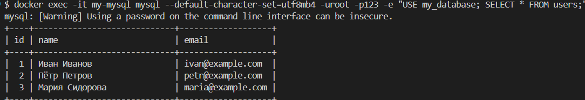
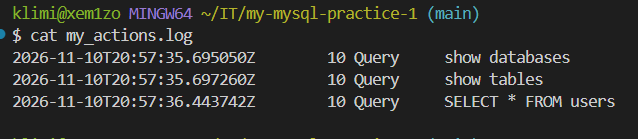

# Практическая работа №1: Интерактивная работа с MySQL в Docker

## 🎯 Цель работы
Запустить изолированный контейнер MySQL, освоить основные операции с базами данных (CRUD), настроить логирование в файл и создать резервную копию (дамп) базы данных.

## ⚙️ Выполненные шаги
1. Настроен файл `my.cnf` для поддержки кириллицы (`utf8mb4`) и логирования в файл (`log_output = FILE`).
2. Запущен Docker-контейнер на базе `mysql:8.0`.
3. Создана база данных `my_database` и таблица `users`.
4. Выполнены операции CRUD (INSERT, SELECT, UPDATE, DELETE).
5. Создан дамп базы данных `dump_clean.sql` (с флагами `--single-transaction`, `--set-gtid-purged=OFF`).
6. Выгружен и отфильтрован лог запросов `my_actions.log` (удалены служебные записи).

## 📁 Описание файлов
* **`my.cnf`** — конфигурация MySQL.
* **`dump_clean.sql`** — дамп базы данных `my_database`.
* **`my_actions.log`** — отфильтрованный лог SQL-запросов.
* **`README.md`** — описание работы.

## 📸 Скриншоты результатов

